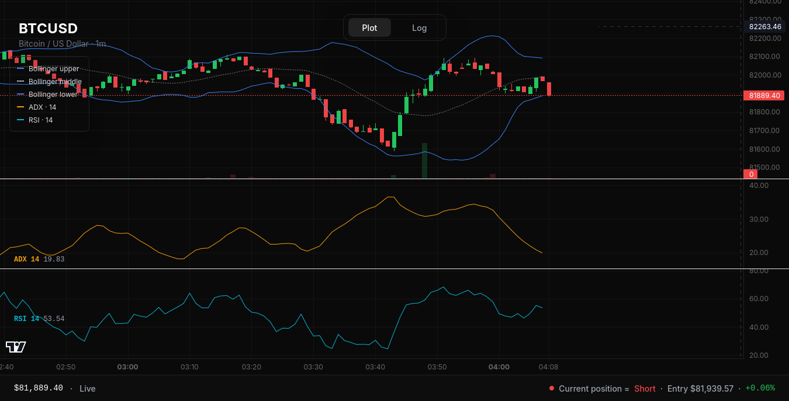
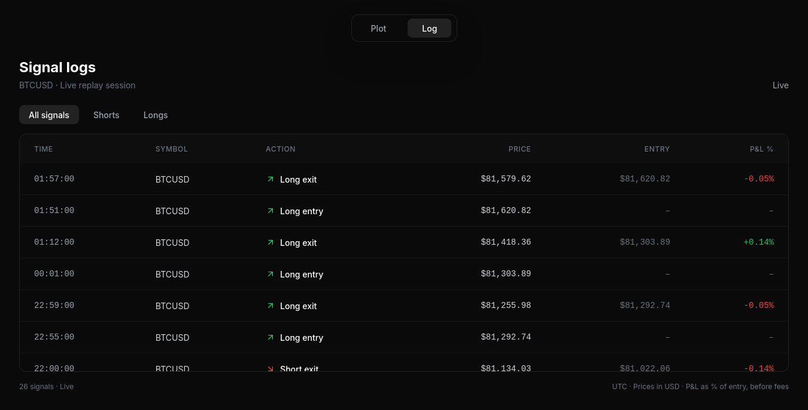
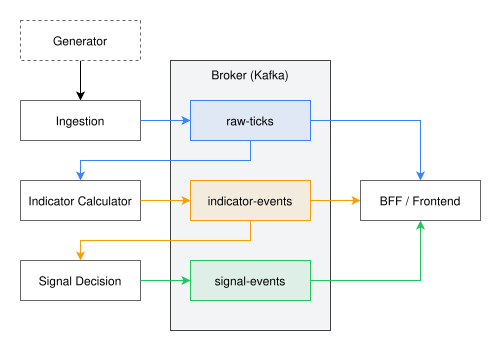

# trading-signals-platform

Market data in, trading signals out. Five services in Go, Java, Python, and TypeScript, exchanging Protobuf events over three Kafka topics.

<div align="center">
  
  
</div>

## Repository Structure


```text
.
├── .github/                  # CI workflows, Dependabot, and security policy
├── charts/                   # Helm charts for cluster deployment
│   ├── app/                  # Microservices (BFF, generator, ingestion, etc.)
│   └── platform/             # Kafka, Strimzi operator, and Kafka topics
├── gen/                      # Generated Protobuf Go stubs (checked in)
├── infra/                    # Cluster provisioning
│   ├── ansible/              # Roles for Cilium, containerd, kubeadm, local-path-provisioner
│   └── Vagrantfile           # Multi-node VM definitions
├── makefiles/                # Modular Makefile targets
├── proto/                    # Protobuf definitions (source of truth)
├── services/                 # Application code
│   ├── bff/                  # Go: Kafka-to-WebSocket bridge + SPA server
│   ├── frontend/             # React SPA (built and embedded into the BFF)
│   ├── generator/            # Python: Market data replay over WebSocket
│   ├── indicator-calculator/ # Java: Kafka Streams stateful processing
│   ├── ingestion/            # Go: WebSocket to Kafka Protobuf mapper
│   └── signal-decision/      # Go: Stateful strategy engine
├── .dockerignore
├── .gitignore
├── buf.gen.yaml              # Buf generation config
├── buf.yaml                  # Buf linting and module config
├── Makefile                  # Top-level orchestrator (includes makefiles/)
└── README.md
```

## Architecture & Tech Stack

<div align="center">
  
</div>

The platform processes time-series market data through a decoupled, event-driven microservice pipeline:

| Component | Tech Stack | Role & Responsibility |
| :--- | :--- | :--- |
| **Market Generator** | Python | Simulates an exchange provider like Binance API, replaying historical candle data (fetched from `yfinance`) as live ticks over WebSocket. |
| **Ingestion Service** | Go (`kafka-go`, Protobuf) | Consumes WebSocket market feeds, validates payloads, and produces `MarketBarEvent` records to the `raw-ticks` Kafka topic. |
| **Indicator Calculator** | Java (Kafka Streams, TA-Lib) | Stateful stream processor maintaining rolling windows per symbol to compute Bollinger Bands, RSI, and ADX/DI, producing to `indicator-events`. |
| **Signal Decision Engine** | Go, Protobuf | Evaluates technical indicators against strategy rules, handles state transitions (`FLAT`, `LONG`, `SHORT`), and produces `SignalEvent` messages to `signal-events`. |
| **BFF & Web UI** | Go, React, Vite, Tailwind | Multiplexes Kafka topics into unified WebSocket streams for the frontend, embedding the SPA build via `go:embed`. |
| **Platform Infra** | K8s, Cilium, Strimzi, Vagrant | 3-node local cluster running Strimzi Kafka (KRaft mode). Ubuntu VMs spun up by Vagrant and provisioned by Ansible to setup Kubernetes using kubeadm and Cilium. |


## Data Contracts & Schemas

To ensure strict type safety across polyglot boundaries (Go, Java, Python), event payloads are centrally defined using **Protocol Buffers (`.proto`)** and managed via **`buf`**:
* **`MarketBarEvent` (`raw-ticks`)**: Symbol, timestamp, OHLCV data. Partitioned by symbol for chronological ordering.
* **`IndicatorEvent` (`indicator-events`)**: Enriched raw bars with computed TA-Lib indicator metrics.
* **`SignalEvent` (`signal-events`)**: Strategy execution outputs (`BUY`, `SELL`, `HOLD`) and position states.


## Some Questionable Architectural Choices and Stack Rationale 

### 1. Resisting the temptation to use an external database
* **Kafka as Source of Truth:** By default, Kafka topic retention is set to 24 hours. Retention could be extended to fully replace a database, or kept a low retention window backed by an external store. An event-sourcing pattern was chosen instead:
  * **Indicator Calculator** relies purely on Kafka changelog topics for state restoration, bypassing local disk storage engines like RocksDB.
  * **Signal Decision Engine** bootstraps its state machine on startup by replaying the tail of its own `signal-events` output topic (acting as a consumer of its own history once upon startup).
* **The Production Reality Check:** This pattern works nicely for a single-ticker local testbench. At production scale with thousands of tickers, memory limits would force the use of external time-series storage (e.g., ClickHouse or TimescaleDB). Furthermore, live user account balances, trades and the related auth logic, belong upstream in exchange APIs (e.g., Binance), therefore no data regarding user is stored on our side.

### 2. Kafka Streams for stream processing
* **The Go-to-Java Switch:** The Indicator Calculator was originally written in Go, but was rewritten in Java using Kafka Streams. 
* **The Trade-Off:** While it introduced JVM memory overhead and brought a second language into the backend stack, Kafka Streams eliminated massive operational headaches: managing manual Kafka connections, writing custom topic-creation code, and handling state changelogs for durability out-of-the-box. This isn't all the features Streams brings in to the table, but probably the most important one. 
* **Why Not Flink or Spark?** Frameworks like Apache Flink or Spark are massive overkills for a small local setup with moderate load. In a heavy big-data or ML production pipeline, Flink or Spark would be the natural choice, but Kafka Streams hits the sweet spot for lightweight, seamless stream processing.

### 3. The Identity Crisis
* **Running Production-Like Architecture Locally:** This project occupies a weird middle-ground. It intially tried to mimic a full-scale, enterprise-grade distributed platform, but is bounded by the physical hardware limitations of a single laptop with limited RAM and CPU cores. 
* **The Result:** It doesn't strictly follow a minimal, hyper-efficient script, nor is it a true production-ready enterprise cluster. And I fully acknowledge this. 
* **The Availability problem:** While some engineering practices were implemented to ensure failure handling, running a heavy K8s, Strimzi, and Cilium stack locally leaves little room for the application pods themselves to breath and scale and have multiple replicas, making this project quite literally **the enemy of availability**.

### 4. Infrastructure & Provisioning: Educational Detours
* **CNI (Flannel vs. Cilium):** The cluster initially ran on Flannel, which was simple and bulletproof. It was migrated to Cilium purely for educational purposes—or more honestly, shamelessly following what's cool in CNCF and looks fancier on a resume, even though Cilium is complete overkill for a local testbed.
* **Ansible vs. Kubespray:** Instead of using production-proven tools like Kubespray to bootstrap Kubernetes, I wrote custom Ansible provisioning scripts from scratch. Is it reinventing the wheel? Absolutely. But spinning up a raw Kubernetes cluster and manually wrestling with CNI routing plugins to get pods talking to each other was hands-down the most challenging and educational part of the entire project.

## Trading Strategy

The platform implements a composite technical strategy to evaluate automated position entries per asset symbol. 

### Indicator Breakdown
* **Bollinger Bands (20, 2.0):** Measures market volatility and identifies potential price extremes by tracking standard deviation boundaries around a 20-period moving average.
* **Relative Strength Index (RSI 14):** A momentum oscillator that measures the velocity of price movements to spot overbought or oversold conditions.
* **Average Directional Index (ADX 14 with +DI / -DI):** Quantifies trend strength (regardless of direction) to filter out choppy sideways markets, while the directional indicators establish trend bias.

### Position Entry Rules

#### Long Position Entry Conditions
* **Confirmed Bullish Trend:** ADX is above the trend threshold (e.g., >25), and `+DI` is strictly greater than `-DI`.
* **Price Pullback:** Price drops to touch or cross below the lower Bollinger Band during an established uptrend.
* **Momentum Reversal:** RSI drops below an oversold level and curls upward, signaling fading selling pressure.
* **State Transition:** The Signal Decision Engine transitions position state from `FLAT` to `LONG` upon a matching `IndicatorEvent`.

#### Short Position Entry Conditions
* **Confirmed Bearish Trend:** ADX is above the trend threshold (e.g., >25), and `-DI` is strictly greater than `+DI`.
* **Price Rally:** Price spikes to touch or cross above the upper Bollinger Band during an established downtrend.
* **Momentum Reversal:** RSI rises above an overbought level and curls downward, signaling fading buying pressure.
* **State Transition:** The Signal Decision Engine transitions position state from `FLAT` to `SHORT` upon a matching `IndicatorEvent`.

**⚠️ Disclaimer:** Do not use this system for actual trading. As seen on the plot page screenshot above, it is a masterclass in making your money disappear. The main purpose of this project was to build a platform for an event-driven pipeline with stream processing—not to design the most money-making strategy.

## Quickstart

### Prerequisites
Make sure you have the following tools installed on your host machine:
* **Virtualization & Cluster:** Vagrant & VirtualBox
* **Containers & Orchestration:** Docker, Helm, `kubectl`
* **Languages & Runtimes:** Go (1.27+), Java (JDK 21), Node.js (v20+), Python (3.12+)
* **Code Generation:** `buf` (for Protocol Buffers)

### Running Locally

The default configuration in the `infra/Vagrantfile` spins up 3 Ubuntu 22.04 virtual machines (1 control-plane and 2 workers), which in total requires 7GB of RAM and 4 cores. So either make sure you meet the default hardware requirements or change the values in the Vagrantfile yourself.

```bash
# Boot the Vagrant VMs, build all container images, and deploy Helm charts
make up
```

Once the cluster is up and all the pods are ready, open your browser and access the web dashboard at: [http://192.168.56.243](http://192.168.56.243)


To bring the platform down, run:
```bash
# Tear down Helm releases and gracefully destroy the Vagrant cluster
make down
```

Additionally, to explore all available build targets, checks, and cluster operations, run:
```bash
make help
```

## Contributing

This is a portfolio project built to explore distributed systems and will likely not be actively maintained. However, pull requests, architectural discussions, bug reports, and feedback are very welcome and highly appreciated!

Feel free to open an issue or submit a PR if you want to chat about the design choices, suggest improvements, or point out areas for optimization.

## License

This project is open source and available under the [MIT License](LICENSE).

